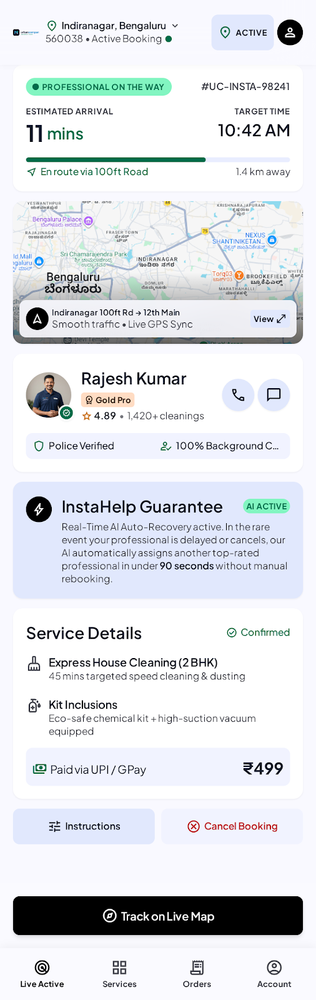
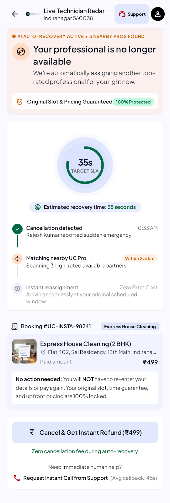
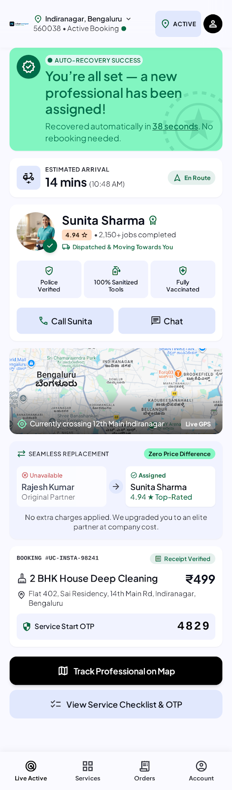
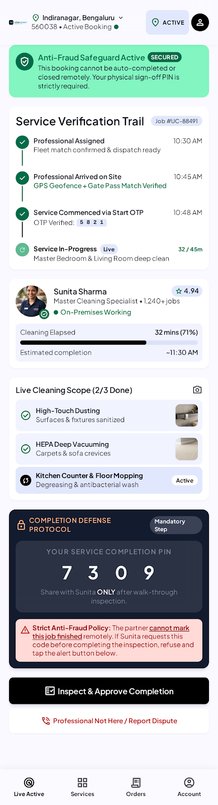
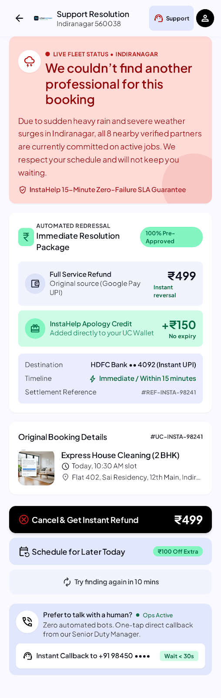

# InstaHelp Real-Time Service Recovery

A product case study: how an on-demand home-services platform should recover when an assigned professional cancels at the last minute.

## The problem

InstaHelp is Urban Company's 15-minute housekeeping service. Demand is strong, but the business loses money on each order (about ₹447 per order in Q4 FY26, per the PRD) because reliability breaks at the point of failure:

- professionals cancel at the last minute
- customers get stuck in an unresolvable chatbot loop
- some bookings are marked complete although nobody arrived

That undermines the 30–40% price premium InstaHelp charges over competitors.

## The proposal

An AI real-time recovery layer. Every cancellation ends in one of three outcomes:

1. **Automatic rematch** to an eligible professional, in the original slot, with no rebooking.
2. **Clear refund or human handoff** when no replacement exists.
3. **Verified completion**, so a booking is only closed when service is confirmed (OTP at the door).

Targets (from the PRD): recovery attempt within 30 seconds for 95% of cases, at least 80% of eligible cancellations recovered, no more than 2 customer interactions. Every event is written to an audit log.

## Screens

| Booking confirmed | Auto-recovery | Recovered | OTP verification | Recovery failed |
|:-:|:-:|:-:|:-:|:-:|
|  |  |  |  |  |

## Documents

- [`docs/PRD.docx`](docs/PRD.docx): the full product requirements document (problem, goals, metrics, personas, journey map, prioritisation, requirements, mock-ups)
- [`docs/context.md`](docs/context.md): background and scope
- [`docs/plan.md`](docs/plan.md): phased delivery plan and target architecture
- [`screens/DESIGN.md`](screens/DESIGN.md): design system notes for the screens

## Prototype

**Live demo:** https://vaswanipranjal.github.io/Instahelp_PRD/

A static, mobile-first screen of the "auto-recovery in progress" state, built with Vite and vanilla JavaScript.

```bash
git clone https://github.com/vaswanipranjal/Instahelp_PRD.git
cd Instahelp_PRD
npm install
npm run dev
```

Then open http://localhost:3000/.

**Status:** the prototype is one static screen with hard-coded data. The other screens exist as design exports in `screens/`. A clickable flow across all five is the next step.

## Repository layout

```
.
├── README.md
├── docs/            PRD, context, plan
├── screens/         screen exports (PNG + HTML) and DESIGN.md
├── src/main.js      prototype
├── index.html
├── vite.config.js
└── package.json
```
